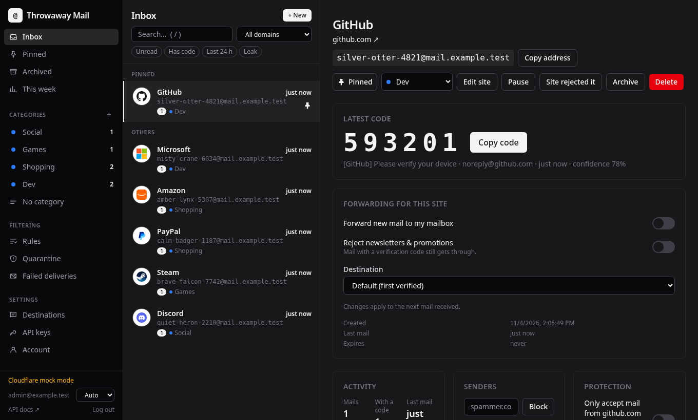
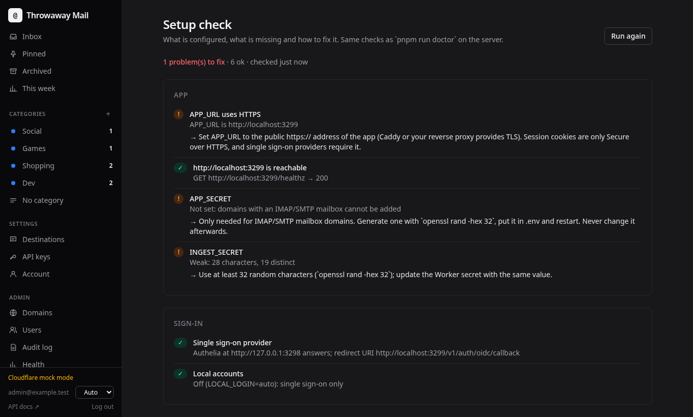

# Throwaway Mail

Self-hosted disposable e-mail addresses on Cloudflare Email Routing or any catch-all IMAP mailbox. Give every website its own address, read
verification codes in the web UI, the API or your browser, choose per site whether mail reaches your real mailbox, and
see when a site leaks or sells your address.



```
Sender → Cloudflare MX → Email Routing catch-all → Email Worker ──HMAC──▶ App (API + web UI, SQLite)
                                                        ▲                       │
                                                        └── forward / reject ◀──┘
```

No mail server to run: Cloudflare receives and forwards, the app stores, parses and decides. Without Cloudflare, the
app polls a catch-all mailbox of any provider over IMAP and forwards over SMTP. It fits on a 1 GB VPS.

## Features

**Addresses**

- One address per site, readable local parts (`amber-otter-4821@your-domain`) or your own format, several domains
- Verification codes and confirmation links extracted automatically (English and French), long-poll API
- On-the-fly addresses: `name.anysite@your-domain` creates the address when its first mail arrives
- Expiring and self-destructing addresses (after N mails or after the first code), with reminders

**Inbox**

- Categories with drag and drop, auto-sort keywords, hidden categories and per-category retention
- Pins, multi-select, quick filters, smart folders, full-text search, keyboard shortcuts
- Tracker removal, phishing warnings, one-click unsubscribe, newsletter blocking
- Weekly digest, per-address statistics, private RSS / JSON feeds

**Privacy**

- Sites that reject alias domains: one click records it and moves the address to another of your domains; new
  addresses for that site skip the domain; optional random or rotating domain choice; "no mail yet" warning
- Leak detection when an address receives mail from another sender than its site, with history and one-click
  replacement of the address
- Site lock and per-address sender blocking
- Forwarding to one or several verified mailboxes, optionally PGP-encrypted
- Reply from the alias: answers go out from the disposable address, your real one stays hidden (needs outbound SMTP)
- Panic button, encrypted export, import from SimpleLogin and addy.io

**Integrations**

- Push notifications: ntfy, Gotify, Telegram, signed webhooks with retries and a delivery log (n8n, Zapier, Home Assistant)
- Send new mail from any alias: compose dialog, API, or any mail client through the optional SMTP submission server
- Firefox and Chrome extension ([Aliasfill](https://github.com/PierreEbele/Aliasfill)): fills sign-up forms with a fresh address and pastes the code
- Bitwarden / Vaultwarden username generator (SimpleLogin and addy.io compatible API)
- REST API with OpenAPI docs, live events (SSE) and a [Node.js SDK](sdk/README.md)

**Operations**

- Multi-user: local accounts with invite links, and/or single sign-on (OpenID Connect, e.g. Authelia) with roles from identity-provider groups
- Optional two-factor authentication (TOTP, recovery codes), login lockout and an audit log
- The app configures Cloudflare itself (zones, catch-all rule, destinations)
- Or no Cloudflare at all: domains backed by an IMAP catch-all mailbox, forwarding over SMTP
- Published Docker image (amd64, arm64), online SQLite backups with encrypted off-site copies (S3, R2, B2)
- Setup check page and `pnpm run doctor`, end-to-end delivery probe, health page, Prometheus metrics
- The Worker keeps forwarding when the app is down and replays the mail later



## Try it locally

Mocked Cloudflare and a fake identity provider that signs you in as an admin:

```bash
pnpm install && pnpm build
pnpm fake-oidc &
CF_MOCK=1 OIDC_ISSUER=http://127.0.0.1:3298 OIDC_CLIENT_SECRET=dev-oidc-secret OIDC_ALLOW_INSECURE=1 pnpm start
```

Open http://localhost:3000, sign in, add a domain (any name), create an address and send it a test mail:

```bash
pnpm simulate --to <address> tests/fixtures/github-device-verification.eml
```

## Documentation

- [Quickstart](docs/quickstart.md): five minutes with Docker and Cloudflare or an IMAP mailbox
- [Comparison](docs/comparison.md) with SimpleLogin, addy.io, Firefox Relay and DuckDuckGo Email Protection
- [Installation](docs/installation.md): server, Cloudflare, Email Worker, single sign-on
- [Tour](docs/tour.md): every screen, with screenshots
- [User guide](docs/user-guide.md) · [Import from SimpleLogin / addy.io](docs/import.md) · [Public demo](docs/demo.md)
- [Configuration](docs/configuration.md) · [Operations](docs/operations.md)
- [API](docs/api.md) · [Node.js SDK](sdk/README.md)
- [Browser extension](docs/extension.md) · [Bitwarden](docs/bitwarden.md)
- [Architecture](docs/architecture.md) · [Development](docs/development.md)

## Requirements

- A domain whose DNS is on Cloudflare (free plan) with Email Routing, or a mail provider offering a catch-all
  mailbox reachable over IMAP (SMTP for forwarding)
- Docker, or Node.js 22+ and pnpm
- Optional: an OpenID Connect provider (Authelia, Authentik, Keycloak, Zitadel…); without one, local accounts are used

## Contributing and security

See [CONTRIBUTING.md](CONTRIBUTING.md). Report vulnerabilities privately as described in [SECURITY.md](SECURITY.md).

## License

[MIT](LICENSE).
