# Tour

A walk through the web UI. The screenshots are generated with `pnpm screenshots` against a demo instance (mocked
Cloudflare, fake identity provider), so they always match the current version.

## Inbox

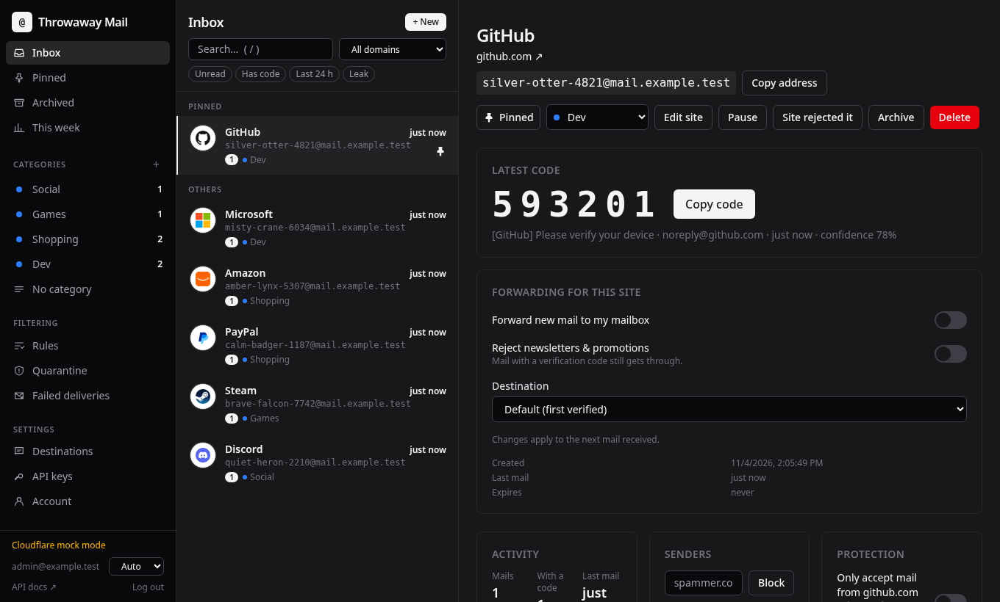

Three columns: navigation and categories on the left, addresses in the middle, the selected address on the right.

- The **latest code** is extracted from the last mail and shown large, with a copy button. Confirmation links are
  extracted too.
- Pinned addresses stay on top. Each row shows the site icon, the address, the unread count and the category.
- **Forwarding for this site** decides whether mail also reaches your real mailbox, and which one.
- **Pause** rejects new mail at the Worker, without deleting anything. **Archive** hides the address from the inbox.
- Keyboard: `/` search, `j`/`k` next and previous, `1`–`9` move to a category, `p` pin, `a` archive, `h` hide a category.

## Creating an address

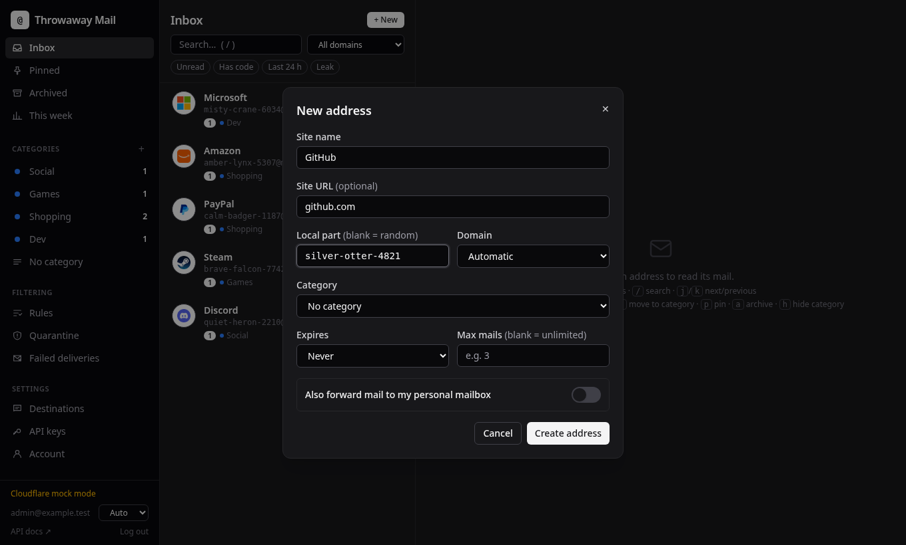

Leave the local part blank for a random readable one (`amber-otter-4821`). An address can be filed in a category right
away, expire after a while, or stop after a number of mails. The browser extension and the API create addresses the
same way.

## Categories

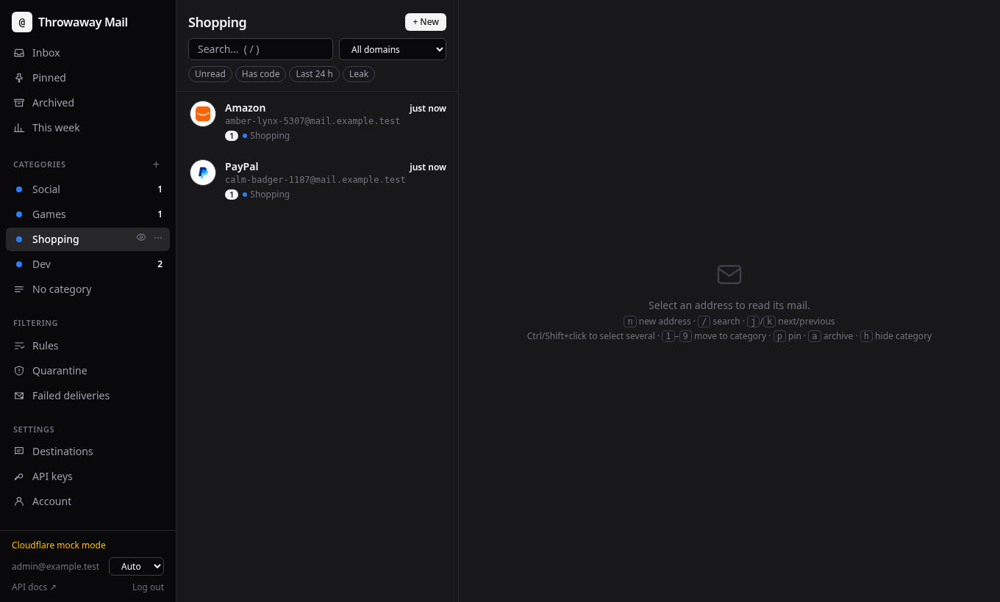

Drag addresses onto a category in the sidebar, or use the category menu on an address. Categories can be hidden from
the inbox, sorted automatically by keywords, and keep mail for their own retention period.

## This week

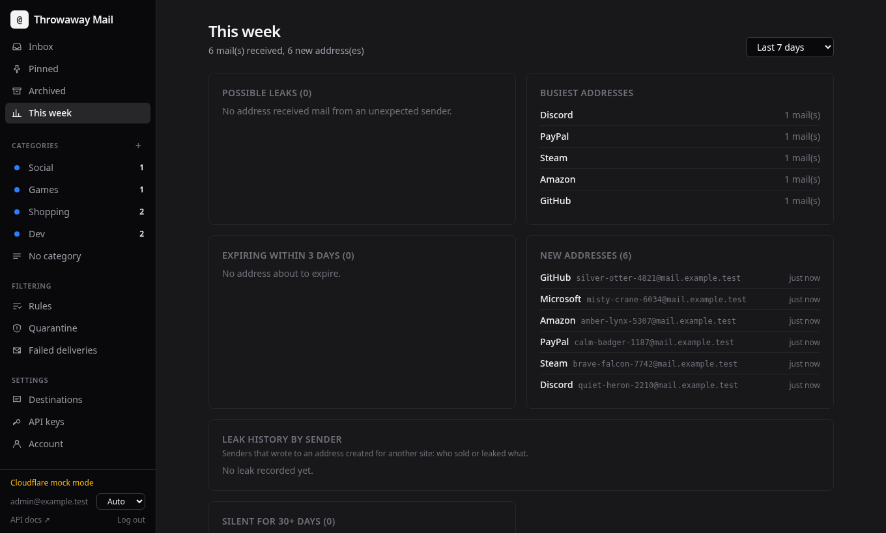

A summary of the last days: possible leaks (mail from a sender that does not match the site), the busiest addresses,
new addresses, addresses about to expire, and addresses that have been silent for a month and could be cleaned up.

## Rules

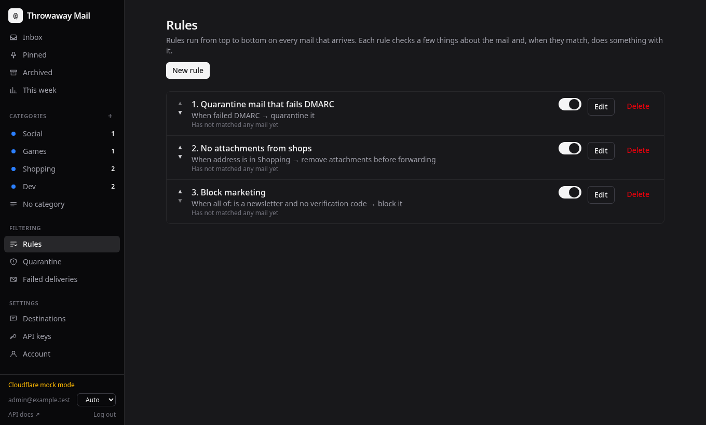

Rules run from top to bottom on every mail that arrives. Each one checks a few things (sender, subject, category,
attachments, failed DMARC, newsletter, verification code…) and then blocks the mail, quarantines it, removes its
attachments, forwards it elsewhere, moves the address or pauses it. "Test" replays a rule on the last 20 mails before
you turn it on. Quarantined mail waits in **Quarantine** until you release or delete it.

## Failed deliveries

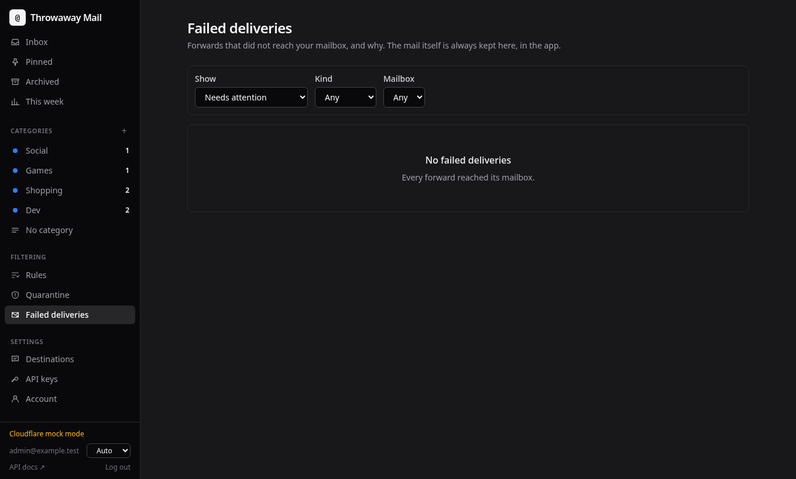

Every forward that did not reach its mailbox, with the reason in plain words and where the mail went instead when a
fallback mailbox took it. Retry when the problem is fixed.

## Account

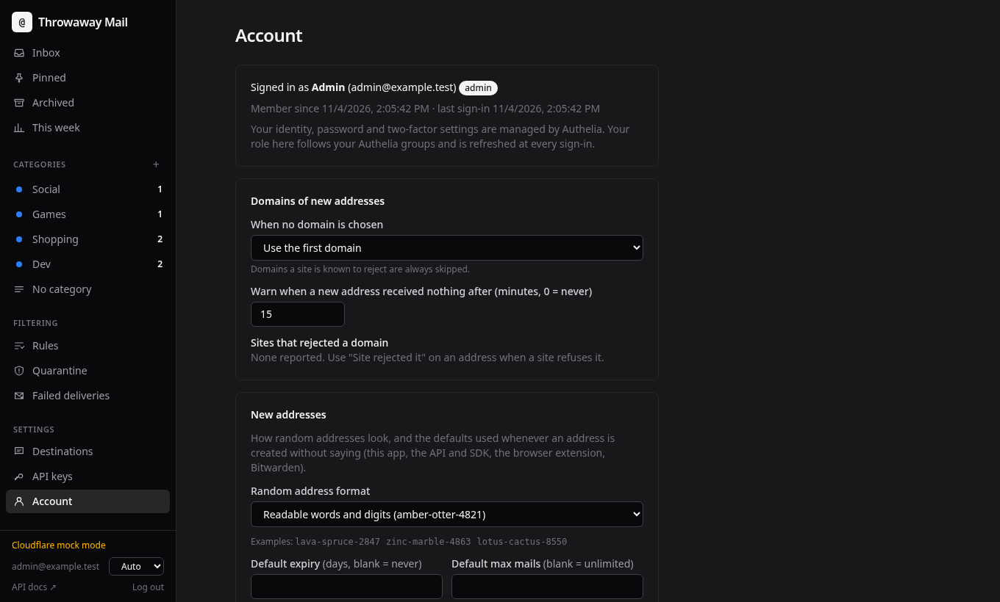

How new addresses look (readable words, random characters or your own template) and their default expiry and mail
limit, which domain new addresses use and the sites that rejected one, passkeys, two-factor authentication, SMTP
passwords for sending from your aliases with a mail client, push notifications and import from SimpleLogin or addy.io.

## Destinations

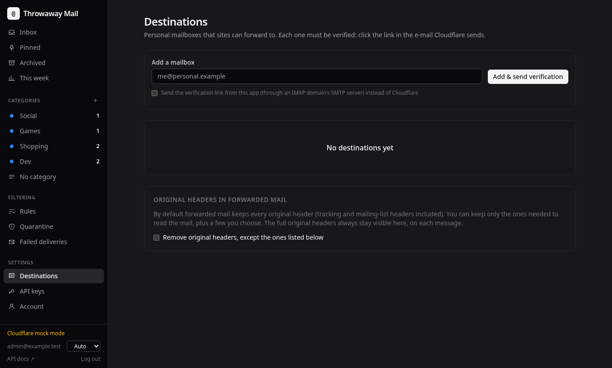

Your real mailboxes. A destination must be verified before mail is forwarded to it: Cloudflare sends the verification
mail for Cloudflare domains, the app sends a link for IMAP/SMTP domains. A PGP public key can be attached to receive
encrypted copies.

## API keys

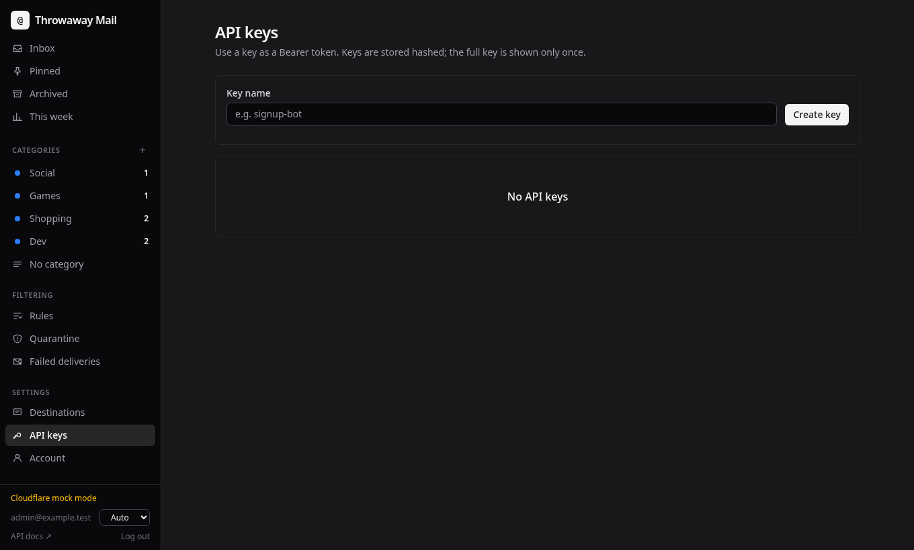

Keys for scripts, the [Node.js SDK](../sdk/README.md), the [browser extension](extension.md) and
[Bitwarden](bitwarden.md). A key acts as the user who created it and can be revoked at any time.

## Administration

### Domains

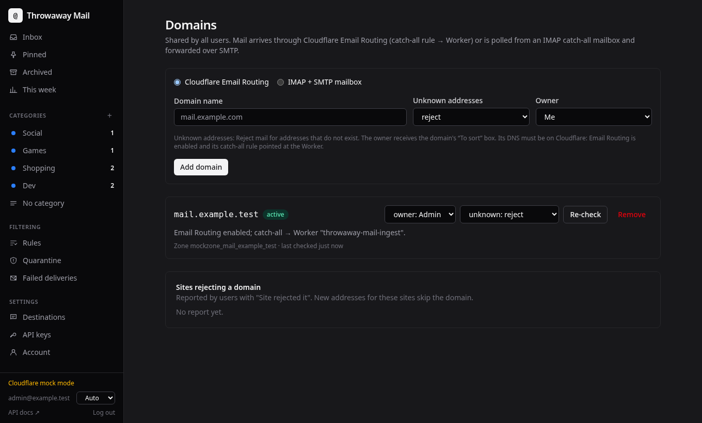

Add a domain on Cloudflare Email Routing (the app sets up the catch-all rule and checks DNS) or backed by an IMAP/SMTP
catch-all mailbox. Each domain chooses what happens to mail for unknown addresses: reject, keep for review, or create
the address on the fly.

### Users

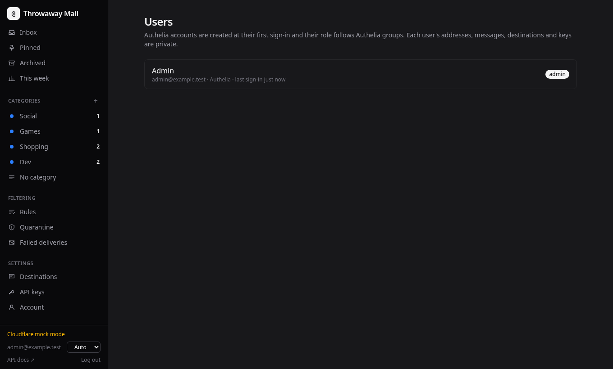

Accounts come from single sign-on, from invite links, or both. Admins can disable an account and reset its two-factor
authentication.

### Audit log

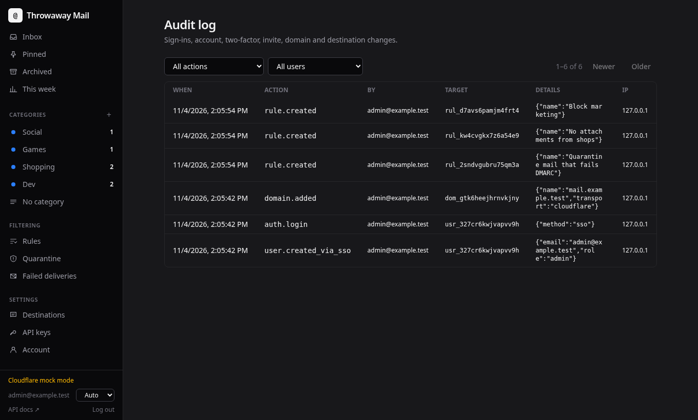

Sign-ins (successful and failed), two-factor and password changes, invites, domains and destinations, with filters by
action and user.

### Health

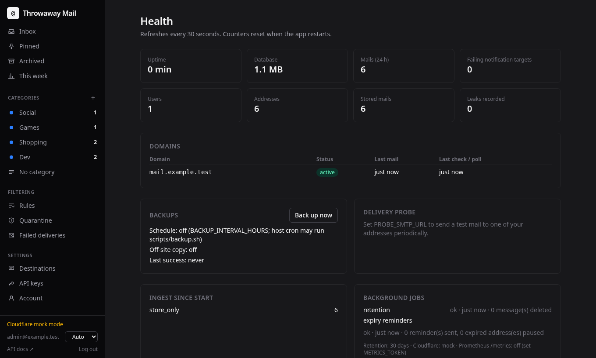

Counters, domain status, backups, the end-to-end delivery probe and background jobs. The same numbers are exported to
Prometheus on `/metrics` when `METRICS_TOKEN` is set.

### Setup check

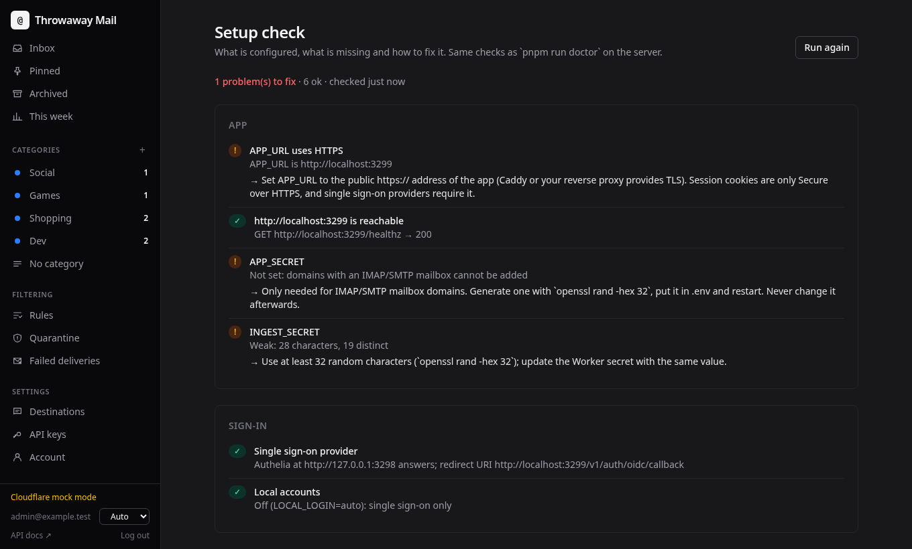

Checks the configuration and explains how to fix what is missing: public URL, secrets, single sign-on, Cloudflare token
and DNS, IMAP mailboxes, backups. `pnpm run doctor` runs the same checks from the command line.
